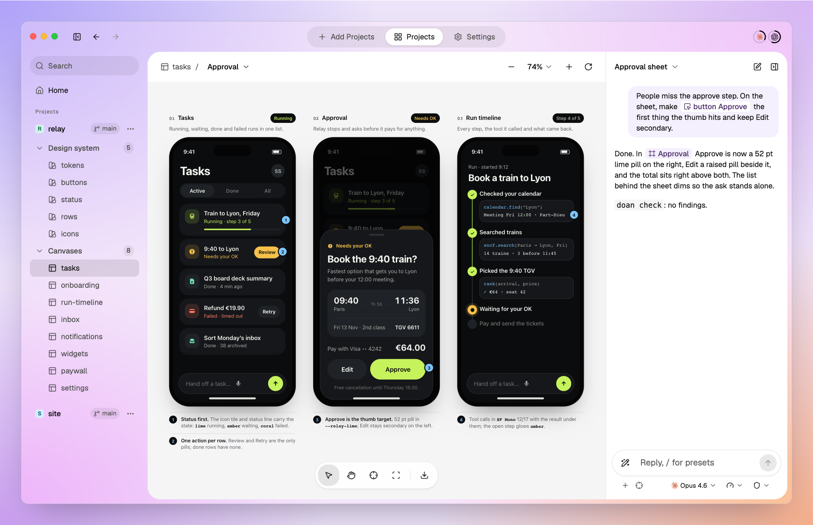
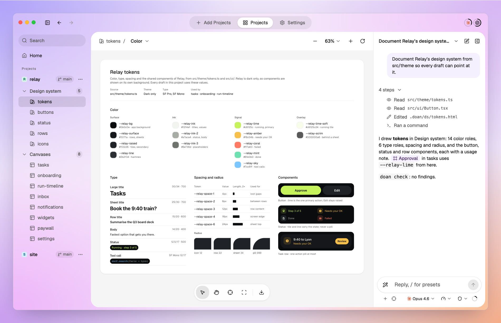
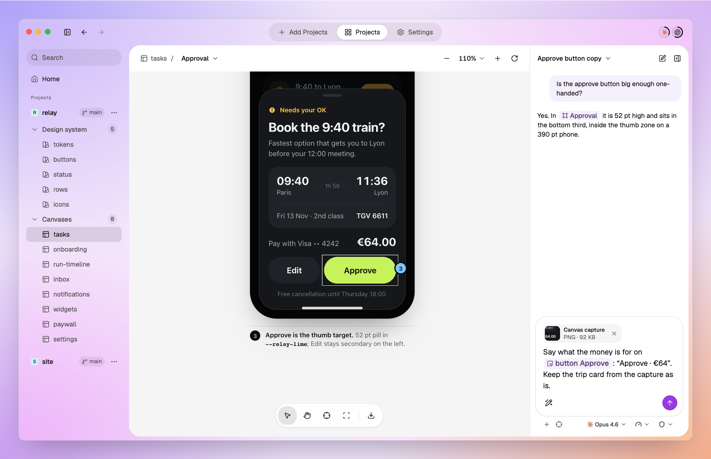
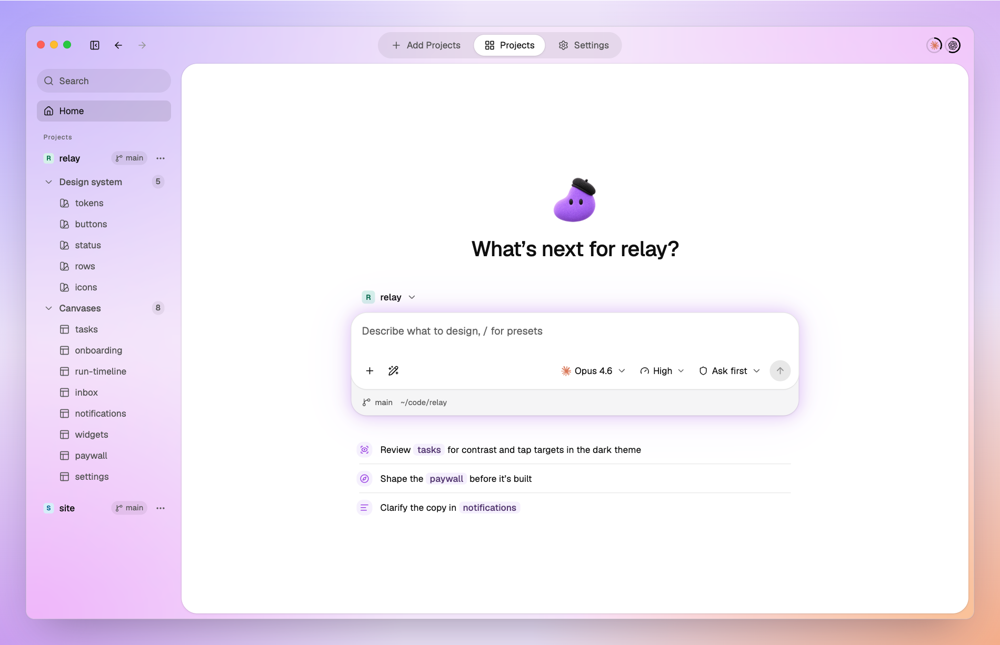
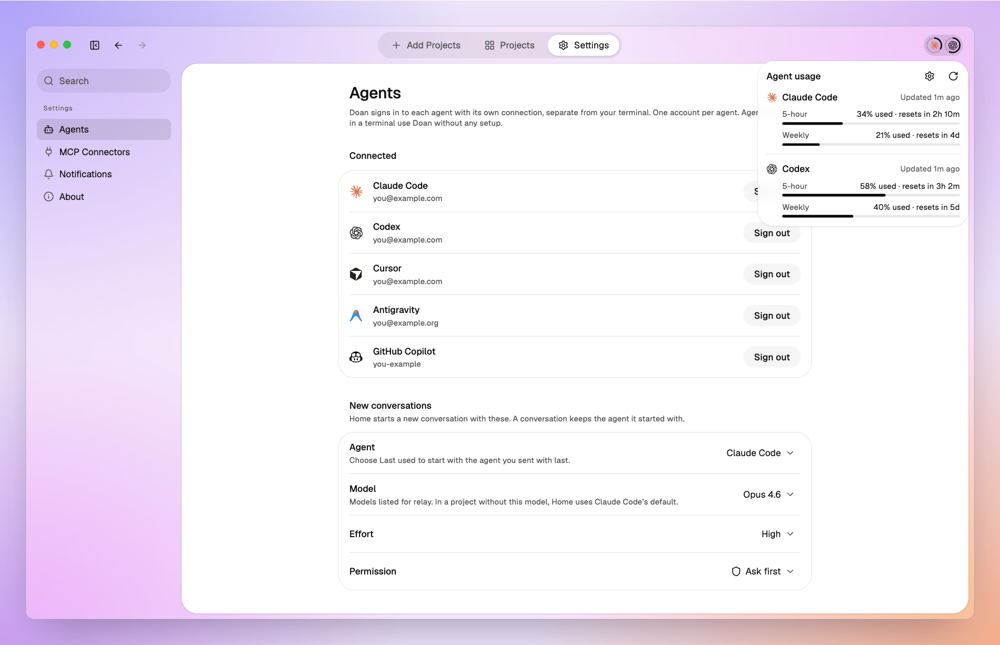
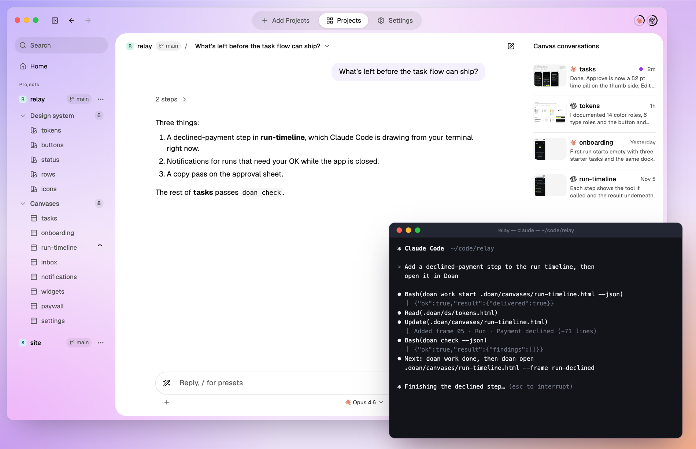
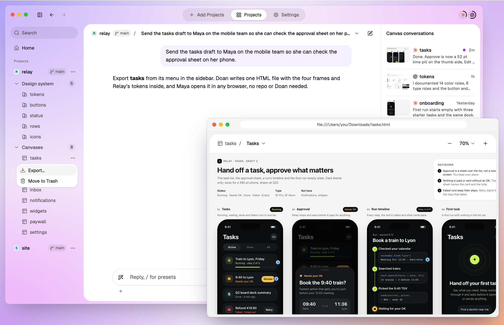
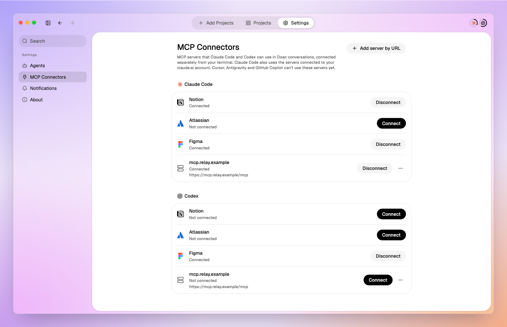
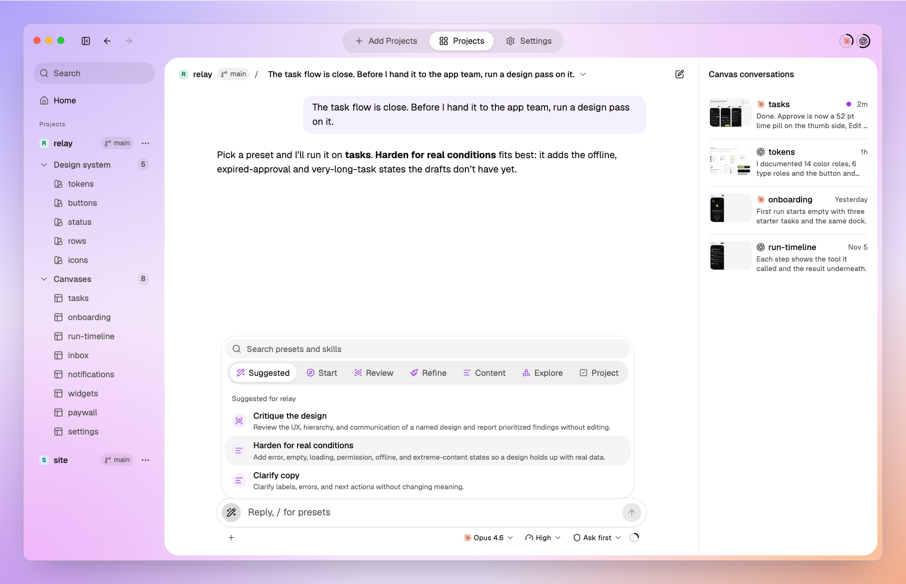

<h1 align="center">
  <br />
  Doan
</h1>

<p align="center">
  <a href="https://github.com/SinhyeokKang/doan-design/releases/latest"></a>
  
  
  
</p>

<p align="center">
  <strong>The agent draws; you view and point.</strong><br/>
  A Mac app and CLI where Claude Code, Codex, Cursor, Antigravity or GitHub Copilot writes design drafts as HTML canvases inside your code repo, and you talk to the agent about them, pointing at frames and elements.
</p>

<h3 align="center"><a href="https://github.com/SinhyeokKang/doan-design/releases/latest/download/Doan-macos-arm64.dmg"><ins>Download for macOS (Apple silicon)</ins></a></h3>

<p align="center">
  
</p>

## Why Doan

- **Design first, then let the agent build.** Doan is a design app made for vibe coding with agents. Settle the screens on a canvas before any code, and the agent implements a design you already agreed on: results become predictable, revision rounds shrink, and fewer tokens go to rework.
- **Drafts live in your repo.** A canvas is an HTML file next to the code, versioned with it unless you keep Doan's files out of Git, not a page in someone else's service that can shut down.
- **Every agent can read it.** Claude Code, Codex, Cursor, Antigravity and GitHub Copilot read the same file through the same `doan` skill, with no upload step.
- **It knows your code.** Canvases use the repo's real token CSS, frames name the files that implement them, and `doan check` flags convention, token and external-resource problems.
- **Point instead of describing.** Put the exact frame, element or spot into your message, and the agent gets it as an anchor.
- **Share without the repo.** Export a canvas as one HTML file that a reviewer opens in any browser.

## Features

<table>
<tr>
<td width="50%" valign="middle">

### Canvases in your repo

The agent writes each canvas as an HTML file in your repo, next to the code, with the repo's real tokens, checks it with `doan check`, and Doan reloads it as the file changes.

</td>
<td width="50%">
  <a href="docs/assets/readme/canvases.png"></a>
</td>
</tr>
<tr>
<td width="50%" valign="middle">

### Talk on the canvas

Each canvas has its own conversation. Point at frames, elements and spots as chips, or capture an area of the board; the agent gets them as anchors.

</td>
<td width="50%">
  <a href="docs/assets/readme/talk.png"></a>
</td>
</tr>
<tr>
<td width="50%" valign="middle">

### Agent conversations

Start from Home with a project, an agent, a model and a permission mode. Queue messages while the agent works, and pick up the same session later.

</td>
<td width="50%">
  <a href="docs/assets/readme/conversations.png"></a>
</td>
</tr>
<tr>
<td width="50%" valign="middle">

### Your agents, your accounts

Sign in to Claude Code, Codex, Cursor, Antigravity and GitHub Copilot with their official logins, separate from your terminal's, and see each account's usage (all but Antigravity).

</td>
<td width="50%">
  <a href="docs/assets/readme/agents.png"></a>
</td>
</tr>
<tr>
<td width="50%" valign="middle">

### Works with terminal agents

Doan sets up the `doan` command and skill for all five agents. A terminal agent marks its canvas with `doan work` and opens the result with `doan open`.

</td>
<td width="50%">
  <a href="docs/assets/readme/terminal.png"></a>
</td>
</tr>
<tr>
<td width="50%" valign="middle">

### Export

Save a canvas as one HTML file that opens in any browser without Doan, the repo or a network, and send it to a reviewer. External URLs a canvas links still load from the internet.

</td>
<td width="50%">
  <a href="docs/assets/readme/export.png"></a>
</td>
</tr>
<tr>
<td width="50%" valign="middle">

### MCP connectors

Claude Code and Codex conversations can use remote MCP servers — Notion, Atlassian, Figma or any HTTPS server — so the agent reads the spec behind a canvas.

</td>
<td width="50%">
  <a href="docs/assets/readme/mcp.png"></a>
</td>
</tr>
<tr>
<td width="50%" valign="middle">

### Design presets

Pick a design preset — shape, critique, harden, clarify and more — and the agent works with that brief. Presets are adapted from Impeccable.

</td>
<td width="50%">
  <a href="docs/assets/readme/presets.png"></a>
</td>
</tr>
</table>

## The `doan` CLI

`doan` is what your agent uses to work with canvases. Doan links it into your agents' sessions when you open the app from Applications, and it ships inside the app. Every command takes `--json`, and every command except `onboarding` takes `--repo <path>`; everything except `active`, `onboarding`, `open`, `handoff` and `remove` works without the app running.

| Command | What it does |
|---|---|
| `doan init` · `doan config` | Set up a repo for Doan: the token CSS canvases use, extra paths canvases may load, and whether Doan's files go in Git |
| `doan ls` | List the repo's canvases and design-system canvases with their frames |
| `doan check` | Check canvases for Doan's conventions, undefined tokens and external resources |
| `doan active` | Read what you selected in the app: canvas, frame and element |
| `doan work start` · `update` · `done` | Show in the app that an agent is working on a canvas, and on which frame |
| `doan open <canvas> --frame <id>` | Open a canvas in the app, at a frame; with `--prototype`, play that frame alone in the prototype window |
| `doan handoff <canvas> --message <text>` | From a Doan canvas conversation, hand the work to a new conversation on a new canvas the turn created, once per new canvas |
| `doan remove` | Take this project out of Doan's list when you ask; its files and Git worktrees stay on disk |
| `doan export <canvas> -o <file>` | Save a canvas as one HTML file that opens in any browser; with `--frame <id> --prototype`, a file that plays only that frame |
| `doan skill` · `doan design-skill [<id>]` | Print the guide agents follow, and the design presets |
| `doan onboarding` | Let an agent run first-time setup for you |

A typical agent turn:

```sh
doan work start .doan/canvases/tasks.html --json
# … the agent edits the canvas …
doan check --json
doan work done .doan/canvases/tasks.html --json
doan open .doan/canvases/tasks.html --frame approval --json
```

## Design presets

Twenty design briefs, adapted from [Impeccable](https://github.com/pbakaus/impeccable), that the agent follows for a focused pass. Pick one from the composer's Presets list or type `/` and its name; agents in a terminal read them with `doan design-skill <id>`.

| Group | Presets |
|---|---|
| Start | `context` gather design context · `shape` shape a feature · `document` document the design system · `extract` extract reusable patterns |
| Review | `critique` critique the design · `audit` check accessibility, responsiveness and theming |
| Refine | `polish` · `bolder` · `quieter` · `layout` · `typeset` · `colorize` |
| Content | `clarify` clarify copy · `distill` simplify · `harden` add real-world states · `onboard` design first use |
| Explore | `adapt` other contexts · `animate` purposeful motion · `delight` moments of delight · `generate` design alternatives |

## Supported agents

| Agent | Conversations in Doan | Terminal sessions (`doan` skill) | MCP connectors |
|---|---|---|---|
| Claude Code | ✓ | ✓ | ✓ |
| Codex | ✓ | ✓ | ✓ |
| Cursor | ✓ | ✓ | — |
| Antigravity | ✓ | ✓ | — |
| GitHub Copilot | ✓ | ✓ | — |

Claude Code, Codex, Cursor and GitHub Copilot run through their installed CLI, which first run offers to install or update; Doan downloads Antigravity's agent server itself. First run then signs in to each.

## Install

- macOS on Apple silicon.
- Download [`Doan-macos-arm64.dmg`](https://github.com/SinhyeokKang/doan-design/releases/latest/download/Doan-macos-arm64.dmg) from the [latest release](https://github.com/SinhyeokKang/doan-design/releases/latest), move Doan to Applications and open it. Each launch from Applications links the `doan` command and the skill for the five agents, with no setup screen; Settings > About shows anything that could not be set up.
- First run signs in to your agents and adds a project: a local folder or a GitHub repository URL.
- Doan updates itself. A copy in Applications checks GitHub Releases at launch and every 6 hours, downloads a new version in the background, and installs it when you press Restart to Update or quit Doan. Settings > About shows the version, checks on demand and can turn automatic checks off.

## Example prompts

Ask your agent, in Doan or in a terminal:

- *"Draw the checkout flow as a Doan canvas: the default form, the card error and the receipt."*
- *"Use our tokens in `src/styles/tokens.css` for the canvas and run `doan check` before you finish."*
- *"Turn this Notion spec into a canvas, one frame per state."* (with the Notion MCP connector)
- *"Export the checkout canvas so I can send it to a reviewer."*

For the best drafts, **give the agent design context**: the repo's tokens and components, a screenshot of the screen as it is, or the spec behind it.

## Community & Support

See [docs/CONTRIBUTING.md](./docs/CONTRIBUTING.md). Please read the [Code of Conduct](./docs/CODE_OF_CONDUCT.md), and report security issues as described in [docs/SECURITY.md](./docs/SECURITY.md).

## Developing

### Build from source

Requirements: macOS on Apple silicon, Node.js with npm (see `.node-version`), Go (see `go.mod`), and Xcode 26 or later for packaging (its `actool` compiles the app icon).

```sh
npm --prefix app ci
(cd app && node -e "require('electron')")   # downloads the Electron binary once
go test ./... && npm --prefix app test      # Go and TypeScript tests
npm --prefix app run package                # unsigned app/dist/mac-arm64/Doan.app with the bundled CLI
```

To run the CLI directly: `go run ./cli/cmd/doan <command> --repo <path> [--json]`. Development and verification commands are listed in [AGENTS.md](./AGENTS.md) 'Commands'.

### Documents

| Document | Contents |
|---|---|
| [docs/PRODUCT.md](./docs/PRODUCT.md) | Problem, users, scope, core loop, MVP — the source of truth for product decisions |
| [docs/ARCHITECTURE.md](./docs/ARCHITECTURE.md) | Conventions, formats, rendering, CLI ↔ app, skills, stack — the source of truth for structure |
| [docs/BACKLOG.md](./docs/BACKLOG.md) | Open product questions, unverified surfaces, known defects |
| [docs/DESIGN.md](./docs/DESIGN.md) | Measured values of the app UI |
| [docs/DIRECTORY.md](./docs/DIRECTORY.md) | Directory layout |
| [docs/USABILITY-EVAL.md](./docs/USABILITY-EVAL.md) | How agents fare writing and reading Doan designs |
| [docs/POSTMORTEM.md](./docs/POSTMORTEM.md) | Pitfalls recorded from bugs and regressions |
| [AGENTS.md](./AGENTS.md) | How agents work in this repo |

## Background

Doan comes from building [malmoi](https://github.com/SinhyeokKang/malmoi) and [BugShot](https://github.com/SinhyeokKang/bugshot-2) with coding agents in 2026, where the design process itself kept getting in the way. Doan is built the same way: every screen of the app was drafted as a Doan canvas by Claude Code and Codex and reviewed in Doan before it was implemented, and those canvases are in this repo under [`.doan/canvases/`](./.doan/canvases/). The problems Doan answers, and the evidence behind them, are in [docs/PRODUCT.md §1](./docs/PRODUCT.md#1-problem).

## License

Apache-2.0 ([LICENSE](./LICENSE)).
